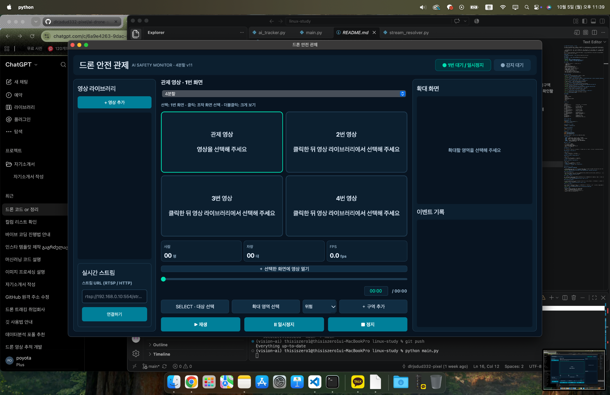

# AI 드론 산업안전 관제

영상 속 사람·차량과 안전 사건을 탐지하고, 운영자가 **모의 순찰이 멈춘 이유와 다음에 할 조작**을 확인할 수 있도록 만든 Python 관제 프로젝트입니다. 초기 OpenCV 탐지 화면에서 시작해 PySide6 다중 영상 관제, PX4/Gazebo 연동 실험, 규칙 기반 모의 순찰로 발전했습니다.

**Python · OpenCV · YOLO · PySide6 · PX4/MAVLink · Gazebo**

## 실행 화면과 시연

*4분할 영상 관제 UI의 초기 화면입니다. 선택한 영상과 확대 화면, 안전 이벤트를 함께 확인할 수 있습니다.*

[초기 영상 탐지 시연 보기 또는 다운로드 · MP4 약 40초](https://github.com/dlrjsdud332-pixel/ai-drone-safety-monitoring/blob/333486b812ff937c8a917e374cabddb3589c874d/docs/drone_safety_demo.mp4)

## 개발 과정

| 단계 | 구현과 검증 | 개발 기록 |
| --- | --- | --- |
| 1. 영상 탐지 | OpenCV와 YOLO로 사람·차량을 탐지하고 추적했습니다. 위험구역 표시와 이벤트 기록을 추가했습니다. | [첫 공개 커밋](https://github.com/dlrjsdud332-pixel/ai-drone-safety-monitoring/commit/5b60eb8) |
| 2. 다중 영상 관제 | PySide6에서 1·2·4화면 전환, 영상 재생과 시간 이동, 대상·영역 확대를 구현했습니다. 다각형 위험구역, 보호구 미착용, 넘어짐 의심 이벤트를 화면과 CSV에 기록했습니다. | [관제 UI와 실행 가이드](https://github.com/dlrjsdud332-pixel/ai-drone-safety-monitoring/blob/5f686341610588231ffd2017b6fb5b480d5e33c4/README.md) |
| 3. 관제와 시뮬레이션 연동 | 이벤트 필터링·저장을 개선하고, PX4/MAVLink 관측과 Gazebo X500 카메라 연동을 실험했습니다. | [이벤트 저장 개선](https://github.com/dlrjsdud332-pixel/ai-drone-safety-monitoring/commit/b4a28a7) · [PX4/Gazebo 프로토타입 검증 기록](https://github.com/dlrjsdud332-pixel/ai-drone-safety-monitoring/blob/release/prototype-v0.1/docs/VALIDATION_REPORT.md) |
| 4. 운영자 확인 기반 모의 순찰 | 상태와 판단 이유를 표시하고, 사건 유형별 재개 조건과 관측 유실·만료 처리를 구현했습니다. | 아래 설계 및 최신 개발본 검증 참고 |

## 모의 순찰 설계

탐지 결과만 표시하면 운영자가 순찰이 왜 멈췄는지 알기 어렵습니다. 영상이 끊겨 경고가 사라지면 위험이 해제됐다고 오인할 수 있습니다.

- 화면에 **현재 상태, 판단 이유, 관측 카메라와 사건, 다음 조작**을 함께 표시합니다.
- 작업자 탐지 시 모의 순찰을 대기시킵니다. 운영자가 **사건 확인 → 재개 요청 → 별도 START 조작**을 순서대로 수행하면 재개할 수 있습니다.
- 화재는 운영자가 사건을 확인한 뒤에도 모의 순찰 재개를 차단합니다.
- 관측이 끊기거나 유효 시간이 지나면 **판단 불가**를 표시합니다. 관측 소스가 바뀌면 새 세션을 요구해 이전 결과가 현재 판단에 섞이는 것을 막습니다.

## 검증 범위

| 검증 대상 | 확인 내용 |
| --- | --- |
| 최신 로컬 개발본 | 관련 회귀 테스트 **43개 통과**. Qt 화면에 합성 사건을 입력해 작업자 탐지에 따른 대기, 재개 요청, 화재 재개 차단, 소스 변경 안내를 확인했습니다. |
| 이전 개발본 | 웹캠과 PX4 SITL **읽기 전용 관제**를 약 10분간 검증했습니다. |
| 실기체 | 실제 드론 연결과 비행은 검증 전입니다. |

이 표의 최신 검증 결과는 로컬 개발본 기준입니다. 공개 저장소에서 확인할 수 있는 구현은 아래 코드 안내를 참고하세요.

## 공개 코드 찾아보기

| 경로 | 역할 |
| --- | --- |
| [`main.py`](main.py) | 다중 영상 PySide6 관제 UI |
| [`ai_tracker.py`](ai_tracker.py), [`ai_worker.py`](ai_worker.py) | 객체 탐지·추적과 영상 분석 작업 |
| [`ppe_detector.py`](ppe_detector.py), [`fall_detector.py`](fall_detector.py) | 보호구 검사와 넘어짐 의심 감지 |
| [`legacy/drone_tracker.py`](legacy/drone_tracker.py) | OpenCV 관제와 에이전트 개발 이력이 남은 실행 파일 |
| [`release/prototype-v0.1`](https://github.com/dlrjsdud332-pixel/ai-drone-safety-monitoring/tree/release/prototype-v0.1) | Gazebo 연동 자료와 검증 문서가 있는 프로토타입 브랜치 |

공개 영상 관제 UI의 모델 준비, 설치, 실행 및 화면 조작은 [기존 실행 가이드](https://github.com/dlrjsdud332-pixel/ai-drone-safety-monitoring/blob/5f686341610588231ffd2017b6fb5b480d5e33c4/README.md#설치-및-실행)에 정리되어 있습니다.
