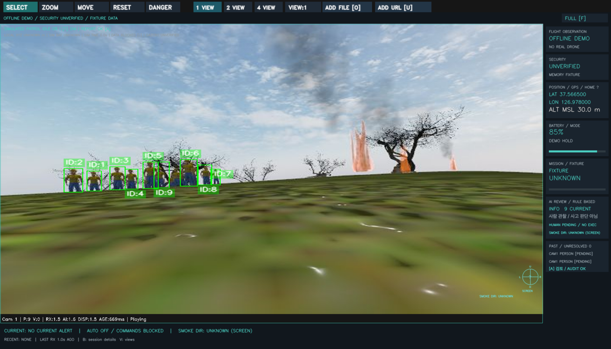
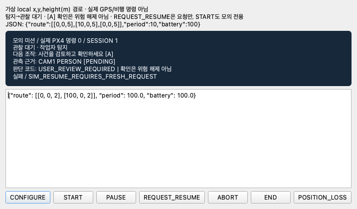
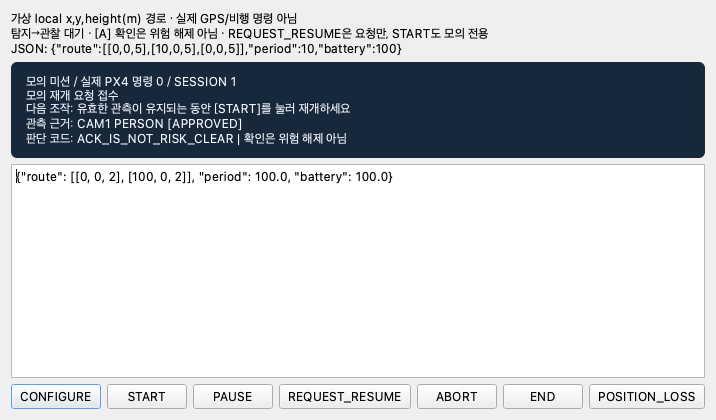
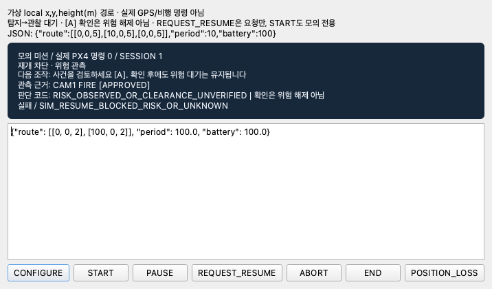
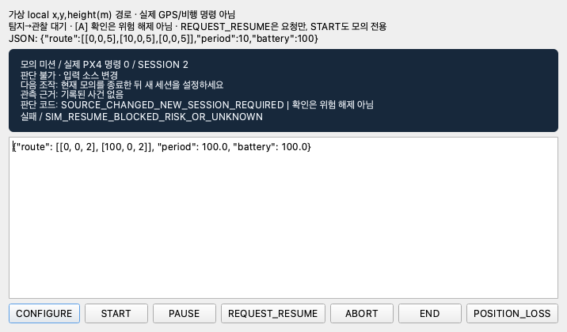

# AI 드론 안전 관제 시스템

**영상에서 안전 사건을 감지하고, 운영자가 모의 순찰을 멈춘 이유와 다음에 할 조작을 확인할 수 있는 Python 데스크톱 관제 시스템입니다.**

Python · PySide6 · OpenCV · YOLO11 · ByteTrack · SQLite · PX4/MAVLink · Gazebo



[**관제 시연 영상 보기 · 13초**](assets/gazebo-monitoring-demo.mp4) · [4분할 화면](assets/monitoring-quad.png) · [시뮬레이터 카메라 입력 예시](assets/wildseed-camera.mp4)

시연에서는 Gazebo 녹화 영상을 관제 앱에 입력해 작업자 추적 ID와 상태 패널을 확인할 수 있습니다. 4분할 화면 예시는 첫 번째 채널에 영상이 연결된 상태입니다.

## 해결한 문제

영상이 끊기면 탐지 경고도 사라질 수 있습니다. 이때 운영자가 위험이 해소됐다고 판단하면 순찰을 잘못 재개할 수 있습니다. 이를 방지하기 위해 **관측의 유효성, 운영자의 사건 확인, 모의 순찰 재개**를 각각 판단하도록 설계했습니다.

| 상황 | 시스템 동작 |
| --- | --- |
| 작업자 탐지 | 모의 순찰을 대기시키고 사건 검토를 요청합니다. 재개는 **사건 확인 → 재개 요청 → START** 순서로 진행합니다. |
| 화재 사건 확인 | 확인 이력을 기록하고 순찰 재개를 차단합니다. |
| 관측 끊김·만료 | **판단 불가**를 표시하고 재개를 차단합니다. |
| 영상 소스 변경 | 새 세션을 요구하고 이전 세션의 관측을 현재 판단에서 제외합니다. |

화면에는 현재 상태와 대기 이유, 관측 카메라와 사건, 다음에 가능한 조작을 함께 표시합니다.

| 작업자 사건 검토 | 재개 요청 후 START 대기 |
| --- | --- |
|  |  |
| **화재 확인 후 재개 차단** | **소스 변경 후 새 세션 안내** |
|  |  |

*Qt 관제 화면에 합성 사건을 입력해 확인한 결과입니다.*

## 주요 구현과 코드

| 구현 | 코드 |
| --- | --- |
| **영상 분석·관제 UI** · OpenCV로 영상을 읽고 YOLO11과 ByteTrack으로 사람·차량을 추적합니다. PySide6에서 1·2·4분할, 대상·영역 확대, 위험구역과 안전 사건을 표시합니다. | [관제 진입점](app/tools/integration/__main__.py) · [영상 분석](app/legacy/drone_tracker.py) |
| **사건 검토·기록** · 관측 결과를 검토할 사건으로 등록하고 운영자의 확인 이력을 SQLite에 저장합니다. | [사건 처리](app/tools/control_agent/core.py) · [이력 저장](app/tools/control_agent/store.py) |
| **모의 순찰 상태 전이** · 관측 유효기간과 세션을 확인하고, 사건 유형과 운영자 입력에 따라 대기·재개 여부를 결정합니다. | [순찰 로직](app/tools/automation/patrol.py) · [관측 처리](app/tools/integration/observation.py) |

## 검증 결과

| 검증 대상 | 결과 |
| --- | --- |
| 전체 개발 저장소 | 모의 순찰, 관제 연결, 화면 표시, 소스 전환, 텔레메트리 내보내기 관련 **로컬 테스트 71개 통과** 기록 |
| 포트폴리오 패키지 | 개발 Mac에서 녹화 영상으로 관제 실행과 화재 이벤트 표시 확인. 합성 사건 데모에서 작업자 확인·START 후 재개와 화재 확인 후 재개 차단 재현 |
| 이전 PX4 SITL 개발본 | 웹캠과 PX4 SITL **읽기 전용 관제 600.33초** 실행. 초기 60초를 제외한 평균 화면 표시 속도 **23.41 FPS** |

이 패키지는 웹캠·로컬 영상 관제와 모의 순찰을 시연합니다. 실기체 연결, 실제 비행, 현장 탐지 정확도와 지연 시간은 검증 전입니다.

## 실행 방법

**모의 순찰 로직만 확인**하려면 저장소 루트에서 실행합니다. Python 표준 라이브러리만 사용합니다.

```bash
python3 app/demo.py
```

<details>
<summary>Mac에서 관제 화면 실행</summary>

1. FFmpeg와 Python 3.10을 준비한 뒤 프로젝트 루트에서 실행합니다.

   ```bash
   python3.10 -m venv .venv
   .venv/bin/python -m pip install -r requirements.txt
   ```

2. 사용 권한이 있는 모델 가중치 `yolo11s.pt`, `yolo11n-pose.pt`, `ppe_best.pt`를 `app/models/`에 배치합니다. 화재·연기 탐지 모델 `fire_smoke_best.pt`는 선택 사항입니다.
3. `01_관제_실행.command`를 더블클릭하면 웹캠으로 시작합니다. 녹화 영상으로 시작하려면 아래 명령을 실행합니다.

   ```bash
   ./01_관제_실행.command --source "/절대경로/영상.mp4"
   ```

4. 관제 창에서 **T**는 모의 순찰, **A**는 사건 검토를 엽니다.

</details>
